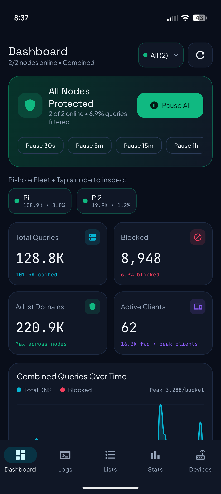
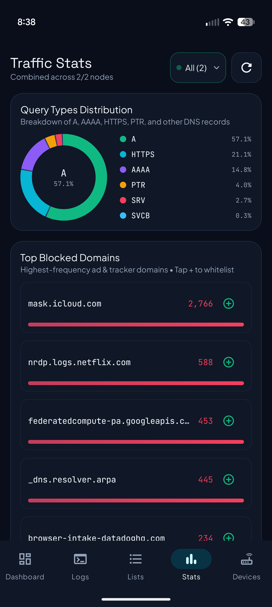
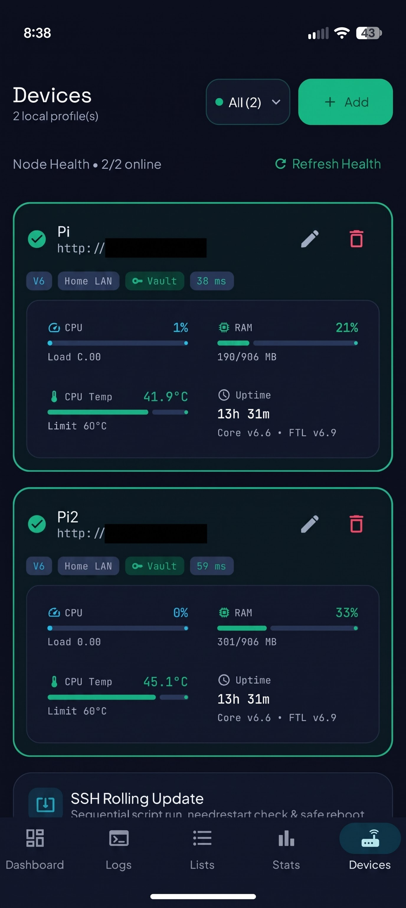
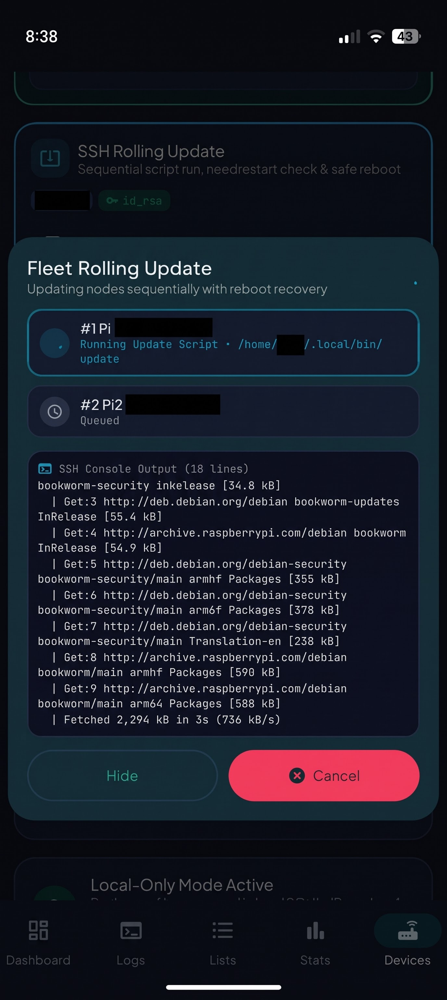

# PiPulse

An Android monitoring app for [Pi-hole](https://pi-hole.net/) network-wide ad and tracker blocking.

## Screenshots

### Dashboard 



### Stats



### Devices 



### Rolling Update



## Project Structure

- `app/` — Android application source code, resources, and module-level configuration
- `gradle/` & `gradle.properties` — Gradle wrapper and build properties
- `build.gradle.kts` & `settings.gradle.kts` — Kotlin Gradle DSL build configuration
- `.env.example` — Template for environment or configuration variables

## Prerequisites

- **Android Studio** (recent release supporting Android Gradle Plugin and Kotlin)
- **JDK** compatible with the project's Gradle version
- **Pi-hole instance** reachable from the device/emulator over your network (or VPN)

## Getting Started

1. **Clone the repository**
   ```bash
   git clone [https://github.com/jkinzer/pipulse.git](https://github.com/jkinzer/pipulse.git)
   cd pipulse
   ```

 * Configure environment variables (if applicable)
   Copy `.env.example` to `.env` and fill in any required configuration values:
   ```bash
   cp .env.example .env
   ```

 * Build and run
   * Open the project directory in Android Studio, allow Gradle sync to finish, and run the app configuration on an emulator or physical device.
   * Or build from the command line using the Gradle wrapper:
     ```bash
     ./gradlew assembleDebug
     ```

## Configuration Notes
 * Ensure your Android device or emulator can reach your Pi-hole host address and port over HTTP/HTTPS.
 * Keep sensitive credentials, API tokens, or local endpoints out of version control (`.gitignore` is configured for local build and environment files).

## Contributing
Contributions, bug reports, and feature suggestions are welcome via issues and pull requests on GitHub.

## License
This project is licensed under the Apache License 2.0. You are free to use, modify, and distribute this software, including for commercial purposes, provided you include the original copyright notice, license text, and a notice of any significant changes made.

## Standard Legal Disclaimer 
PiPulse is an independent project and is not affiliated with or endorsed by Pi-hole LLC. This project is for educational purposes only.
